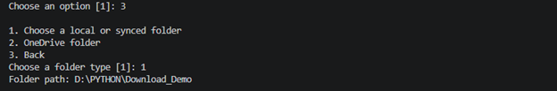
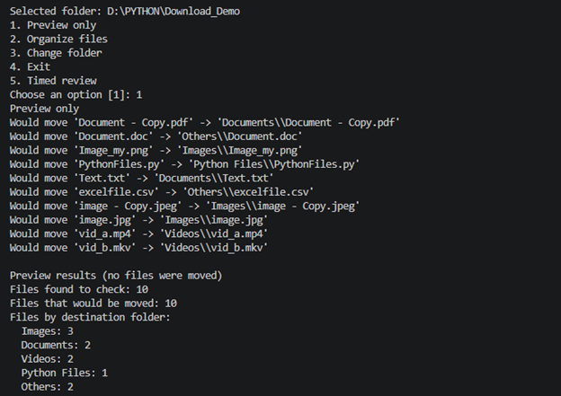
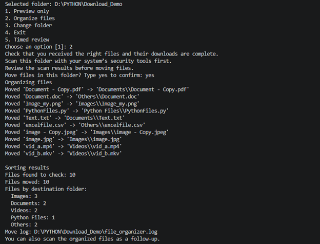
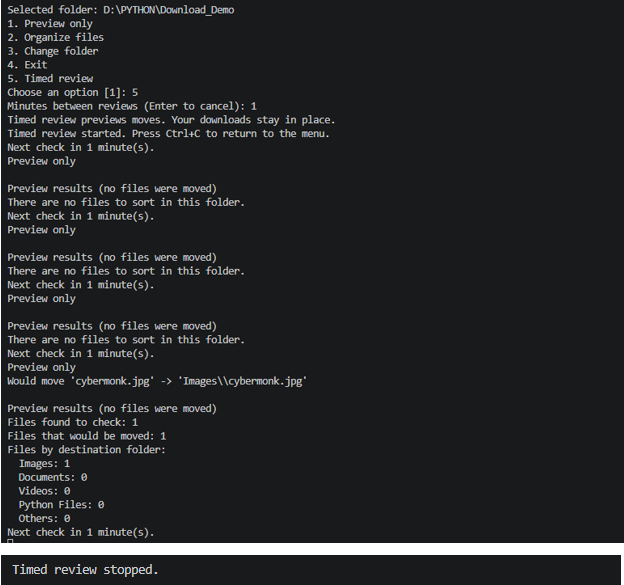

# Smart File Organizer

This is a Terminal based Organize the files directly inside Downloads or any local or cloud-synced folder. The app previews
moves, creates category folders, preserves duplicates with numbered filenames,
and records completed moves in a timestamped history.

| Folder | Extensions |
| --- | --- |
| Images | .jpg, .png, .jpeg |
| Documents | .pdf, .docx, .txt |
| Videos | .mp4, .mkv |
| Python Files | .py |
| Others | Other extensions and files without extensions |

## Required virtual environment setup

Create a local Python virtual environment named `.venv or project_venv` inside the extracted
project folder. It keeps this project's installed packages separate from
the rest of your computer.

### Windows in VS Code

1. Extract the ZIP, then open the `Smart_File_Organizer` folder in VS Code.
   Use Python 3.12 or later on Windows.
2. Open **Terminal → New Terminal** and run these PowerShell commands:

   ```powershell
   python -m venv .venv
   .\.venv\Scripts\python.exe -m pip install -r requirements.txt
   ```

3. Start the organizer using the environment's Python:

   ```powershell
   .\.venv\Scripts\python.exe file_organizer.py
   ```

   On first launch, create and confirm a password of at least eight characters.
   The app saves a salted hash in `.env`. On later launches, enter your password.
   Press Enter at an empty password prompt to leave.

### macOS or Linux

From the extracted project folder, create the environment, install its
dependencies, and verify the interpreter:

```sh
python3 -m venv .venv
.venv/bin/python -m pip install -r requirements.txt
```


Start the app with `.venv/bin/python file_organizer.py` and follow the password prompt.

## Use one session for multiple actions

Choose **3. Change folder** to select your first folder. Choose **1** for a
local or synced folder, **2** for a detected OneDrive folder, or **3** to go back.
Paste the **source folder** path. Destination folders are created inside it.

From the main menu, choose **1. Preview only**, then **2. Organize files** and
type `yes` after reading the security reminder and reviewing your scan results. The app returns to the main menu after
each action or cancellation. You can change folders and repeat. Choose **4. Exit**
when finished. The password unlocks one terminal session.

## Downloads and cloud folders

Select your actual Downloads folder to organize its top-level files. The
organizer skips subfolders, symbolic links, and common incomplete download
extensions (.crdownload, .part, .download). Extensions guide sorting and do
not establish whether a file is safe. Before moving unfamiliar downloads,
scan the folder with your system’s security tools and review the result.
The reminder is manual. The organizer neither scans for malware nor opens
or executes the files it moves. If you suspect infection, handle that first.

Choose any locally accessible synced folder. Examples include a OneDrive
folder on Windows, or a Dropbox or Nextcloud folder on Linux. Use the actual
path configured by your sync client. OneDrive detection is an optional
shortcut. For browser-only storage, organize locally and upload manually.
The organizer does not check cloud upload status.

## Timed review

Option 5 is useful during a long work session when downloads arrive at
different times. It refreshes the same preview shown by Option 1 at your
chosen interval, so you can see newly arrived files without selecting
Preview again each time. We added it to keep the folder easy to check
while leaving downloads in place until you are ready to sort. For a
one-time cleanup, use Option 1 to preview, then Option 2 to confirm the
moves.

Select a source folder with **3. Change folder**, then choose **5. Timed review**.
Enter an interval of 1 to 1440 minutes. The first preview appears after the
interval, and each later check scans the folder again. The terminal must stay
open. Press **Ctrl+C** to return to the menu and choose **2. Organize files** when
you are ready. Timed review leaves files and the move history untouched.

## Prepare a demonstration folder

Create a fresh `Organizer Demo` folder outside the app. Put harmless copies
named `photo.JPG`, `report.txt`, `clip.mp4`, `hello.py`, and `archive.zip`
directly inside it. Add a second `report.txt` with different text inside its
`Documents` subfolder. Add `pending.crdownload` and a separate subfolder with
one file if you want to check the exclusions. Start with no move log.

## Project requirements and checks

| Requirement | How it works | How to verify |
| --- | --- | --- |
| 1. Accept a folder path | Option 3 opens folder selection and checks that the path is an existing directory. | Try a nonexistent path, then select Organizer Demo. Check the selected path above the main menu. |
| 2. Scan using os | `os.scandir()` lists eligible regular files directly inside the source. Subfolders, symbolic links, and reserved files stay in place. | Preview the demo. Expect “Files that would be moved: 5.” The file in the extra subfolder and the partial download should be absent from the preview. |
| 3. Sort five categories | The final extension, compared without case sensitivity, maps to Images, Documents, Videos, Python Files, or Others. | Verify the demo maps photo.JPG, report.txt, clip.mp4, hello.py, and archive.zip to those five folders respectively. |
| 4. Create missing folders | The app creates a category directory when it needs to move a file there. | Start without Images, then organize. Check that Images was created and contains photo.JPG. |
| 5. Use a FileOrganizer class | One object holds the chosen folder and provides methods for scanning, previewing, moving, and logging. | Find `FileOrganizer(folder)` in the menu and trace the stored path into `scan_files()`. |
| 6. Count files by category | A preview counts planned moves. A confirmed run counts successful moves. When there are proposed or completed moves, the breakdown lists all categories. If an error prevents a move, the app explains which file stayed in place and why. | Preview before sorting and expect one planned move per category. After sorting, expect one moved per category and five moves total. |
| 7. Preserve duplicate names | An occupied filename triggers numbered alternatives such as report_1.txt. The app reserves a free destination before moving. | Open both reports after sorting. Check that Documents/report.txt retains its original text and Documents/report_1.txt holds the loose report's text. |
| 8. Summarize and log | The terminal prints the results. The timestamped move history keeps the original name and new location. The first two lines label the history. | After organizing the five demo files, inspect file_organizer.log for the title, labels, and five move entries. Add another file and sort again. The new entry should be appended below the old entries. |
| Bonus. Preview | Option 1 shows proposed moves using the same category and destination rules as sorting. | Run preview on the fresh demo. Compare File Explorer before and after. Expect no moves, new category folders, or log. |

## Additional features and checks

| Feature | How it works | How to verify |
| --- | --- | --- |
| Confirmed batch sorting | Option 2 moves the batch only after confirmation. | Type no and check that nothing changed. Run it again and type yes when ready. |
| Read-only timed review | Option 5 automatically previews all five categories at each interval. Files added later appear on a later check. | Choose one minute. After the first preview, add another sample file and wait for the second. Check that both samples remain in place and the log stays unchanged. Press Ctrl+C to return to the menu. |
| Download and security review | Before sorting, confirm downloads are complete and review the results from your own antivirus. The app offers a follow-up scan reminder after the move. It moves files without executing them. | Choose Option 2 and read the reminder before confirming. After a confirmed demo move, check for the follow-up reminder. The app does not verify scans, and file extensions do not indicate safety. |
| Incomplete-download filter | Both previews and sorting leave common partial names (.crdownload, .part, .download) in place. | Add pending.crdownload before previewing and confirm it remains after sorting. A filename filter cannot detect every download in progress. |
| Local or cloud-synced folders | Any locally accessible folder can be selected. The OneDrive shortcut detects a configured path. Your sync client handles cloud uploads. | Select a local folder first. For cloud verification, sort test copies in a synced folder, wait for sync, and open a sorted copy on another device. |
| Password and private setup | Each user creates a password at a hidden prompt. The app stores its salted scrypt hash in a local .env. The shareable template contains no password. | Try a wrong password and then the correct one. Confirm the ZIP has .env.example and .gitignore, and contains no real .env. |
| One session with multiple actions | Preview, organize, and changing folders return to the same menu. Option 4 exits. | Preview, cancel an organize run, select another folder, then choose Option 4. |
| Move errors and overlapping runs | A blocked destination reports that a file stayed in place and explains why. A folder lock keeps local organizer sessions from moving files in the same folder at once. | In a separate test folder, create a regular file named Images and add A.JPG. Confirm a run and check that A.JPG stays put and the summary shows one file left in place. |
| Repeat use | Each scan checks the current top-level files. Previously sorted files stay inside their category folders. | Reopen the organizer later, select the same folder, and preview. Only eligible files still at the top level appear. |

## Read the move history

```text
SMART FILE ORGANIZER - FILE MOVE HISTORY
Date and time (local) | Original file -> New location
2026-11-13T09:05:00 | 'report.txt' -> 'Documents/report_1.txt'
```

A confirmed run with files to process adds the heading to older logs while
preserving their records. Future moves append beneath it. The title stays at
the top of the text file. The viewer controls what stays visible while scrolling.
Run one organizer per folder at a time. If the app was forcibly closed and
still reports a lock, close any other organizer session for the folder before
removing the stale .file_organizer.lock file.


## Demonstration









The timed review capture uses simulated waits to demonstrate two checks. The
one-minute verification above lets you try the actual interval.


